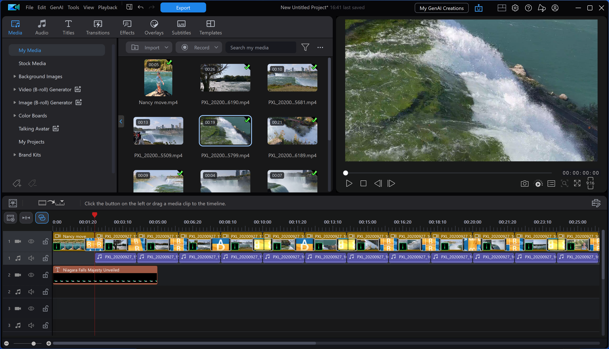
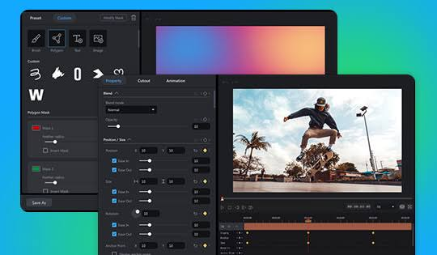

# PowerDirector Essential for Timeline Editing and Video Production

PowerDirector Essential is CyberLink's free edition for editing and exporting video.
It provides a way to work with clips, titles, transitions, and selected creative tools.

This independent Cyberlink PowerDirector guide focuses on planning edits and reviewing finished files.
PowerDirector Essential should be evaluated separately from paid PowerDirector editions and subscriptions.

[](https://powerdirector-essential.github.io/Cyberlink-PowerDirector/)

The supplied source snapshot belongs to Shotcut, a separate open-source video editor.
Its linked files provide comparative references for filters, export testing, and interface maintenance.
They are not PowerDirector source code, CyberLink presets, or a PowerDirector installer.

## Features

When evaluating powerdirector AI options, check which tools are available in the installed edition.
A feature shown in a product demonstration may have different limits or licensing conditions.

| Editing decision | Practical approach | Final review |
| --- | --- | --- |
| Clip selection | Keep material that supports the intended story | Remove accidental gaps and unused endings |
| Timeline structure | Organize the main sequence before adding decoration | Check continuity and the order of events |
| Titles | Match text size and contrast to the viewing context | Inspect spelling, placement, and reading time |
| Transitions | Use them to clarify a change between shots | Check the frames immediately before and after |
| Audio balance | Keep narration understandable alongside other sound | Listen for abrupt changes and overloaded peaks |
| Delivery | Choose settings for the intended destination | Reopen the exported file and review it completely |

The [official Essential page](https://www.cyberlink.com/downloads/trials/powerdirector-video-editing-software/download_en_US.html) describes the free product.
Confirm export conditions and premium asset requirements before committing to a long project.

A powerdirector video editor workflow benefits from a clear separation between source media and delivery files.
Preserve camera recordings and maintain an editable project alongside the final export.

- Use descriptive names for media and project revisions.
- Check whether an effect changes the apparent timing of an action.
- Keep text within a readable area of the frame.
- Review motion rather than judging an effect from one paused frame.



The supplied Shotcut filter sets illustrate effects defined for another editor:

- [Text Simple with Gradient Back](filter-sets/Text%20Simple%20with%20Gradient%20Back)
- [Soft Focus](filter-sets/Soft%20Focus)
- [Obscure With Mosaic](filter-sets/Obscure%20With%20Mosaic)
- [Obscure With Blur](filter-sets/Obscure%20With%20Blur)
- [Glow Intensity](filter-sets/Glow%20Intensity)

These resources contain Shotcut filter definitions in MLT XML.
They are not PowerDirector templates and should not be offered as CyberLink-compatible effects.

## Tutorial

A useful powerdirector video editing software exercise ends with a reviewed delivery file.
Choose a short sequence that includes motion, spoken audio, and at least one text element.

1. Establish what the viewer should understand from the sequence.
2. Arrange the clips so that the action is easy to follow.
3. Refine cuts before adjusting transitions.
4. Balance the narration against music or environmental sound.
5. Review titles at normal playback speed.
6. Export a representative sample and inspect the result.

Use the sample to check the difficult parts of the project.
Fast motion, fine detail, small text, and quiet speech can reveal problems that a static preview misses.

For a vertical version, review framing across the whole shot.
Keeping a subject visible at the start does not establish that the subject remains visible during movement.

The supplied Shotcut tests provide related implementation references:

- [test_subtitles.cpp](tests/test_subtitles.cpp) exercises subtitle-related behavior.
- [test_mix_transition_order.cpp](tests/test_mix_transition_order.cpp) tests transition ordering.

These tests run against Shotcut components.
They do not verify PowerDirector projects or define PowerDirector timeline behavior.

## Documentation

Record the intended output dimensions, frame rate, and audio requirements.
Keep that specification with the project so that later revisions have the same target.

The following PowerShell example uses ffprobe, a separate FFmpeg tool.
It displays properties of the first video stream in an existing export.

```powershell
$mediaInspector = "ffprobe"
$videoFile = "review-export.mp4"
& $mediaInspector -v error -select_streams v:0 -show_entries stream=codec_name,width,height,avg_frame_rate -of json $videoFile
```

This example assumes ffprobe is available in the command environment.
It reads metadata and does not modify the video or launch PowerDirector.

The [ffprobe reference](https://ffmpeg.org/ffprobe.html) documents the stream selection and output options.
Average frame rate may be reported as a fraction, and it does not fully describe variable-frame-rate timing.

Compare the reported dimensions and codec with the delivery requirements.
Then inspect the actual pictures and sound in the exported file.

The supplied Shotcut export references are:

- [test_exportpresetdialog.cpp](tests/test_exportpresetdialog.cpp), which tests export-preset handling.
- [ffmpeg-codecs.sh](scripts/ffmpeg-codecs.sh), which processes codec information.

Their preset logic and command processing belong to Shotcut.
They do not provide PowerDirector export switches.

## Report a bug

A useful report identifies the stage where the issue becomes visible.
Distinguish a problem in the source clip from a preview problem or an export problem.

Include the relevant details:

- PowerDirector version and edition.
- Operating system and graphics hardware.
- Source container, codec, dimensions, and frame rate.
- The operation or effect associated with the issue.
- Whether the same issue appears in a short sample export.
- The exact message displayed by the application.

When sharing an approved sample, a file hash can help identify the exact copy under discussion.
This Python example calculates SHA-256 for an existing file without changing its contents.

```python
import hashlib
digest = hashlib.sha256()
with open("review-export.mp4", "rb") as video:
    for chunk in iter(lambda: video.read(1024 * 1024), b""):
        digest.update(chunk)
print(digest.hexdigest())
```

The example assumes Python is available and the named video already exists.
It uses the standard [hashlib module](https://docs.python.org/3/library/hashlib.html).

A matching hash helps compare two copies of the same file.
It does not assess visual quality, audio quality, or editing accuracy.

The supplied Shotcut implementation tests include:

- [test_gpuinfo.cpp](tests/test_gpuinfo.cpp) for graphics-related selection logic.
- [test_dataqueue.cpp](tests/test_dataqueue.cpp) for data queue behavior.
- [test_addonqmlgenerator.cpp](tests/test_addonqmlgenerator.cpp) for add-on QML generation.

These files are comparative development references.
They do not establish how PowerDirector implements hardware acceleration or rendering.



## Translations

Review automatic captions against the actual speech.
Names, specialist vocabulary, and punctuation often need attention even when the overall transcript is readable.

- Check that each caption appears at the appropriate time.
- Avoid covering an important action or existing title.
- Keep line breaks natural.
- Review the finished video at its intended display size.

The supplied [update-tx.sh](scripts/update-tx.sh) maintains Shotcut translation resources.
It concerns application localization rather than PowerDirector caption generation.

## Developers

Documentation changes should clarify a production task or correct a verified product detail.
Identify which application each command, example, and source reference belongs to.

The remaining supplied Shotcut references cover supporting resources:

- [minimalmediaplugin.json](MinimalMediaBackend/minimalmediaplugin.json) declares a minimal media backend key.
- [optimize-png.sh](scripts/optimize-png.sh) optimizes project image assets.
- [shotcut.css](docs/shotcut.css) styles generated documentation.

These resources are not PowerDirector extensions or customization files.
Use the [CyberLink learning center](https://www.cyberlink.com/learning/powerdirector-video-editing-software) for product-specific guidance.

Keep the editable project, source media, and approved export together.
This makes it easier to reproduce the intended result when the project is revised.

## Related Search Terms

Cyberlink PowerDirector, PowerDirector Essential, powerdirector AI, powerdirector video editor, powerdirector video editing software, video-editor, video-editing, video-production, multimedia, audio, subtitles, transitions, effects, windows, macos
